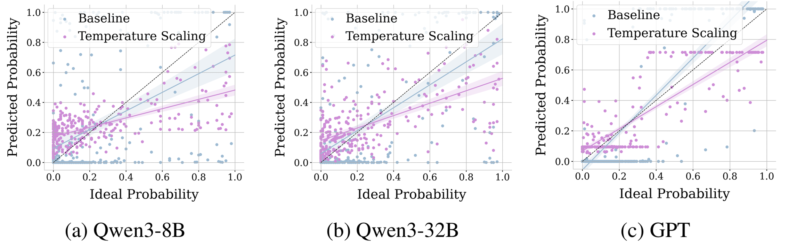
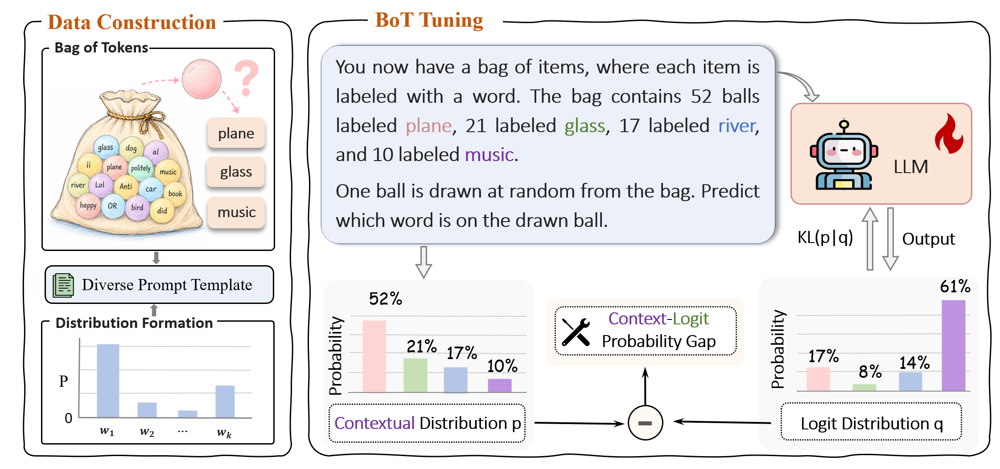
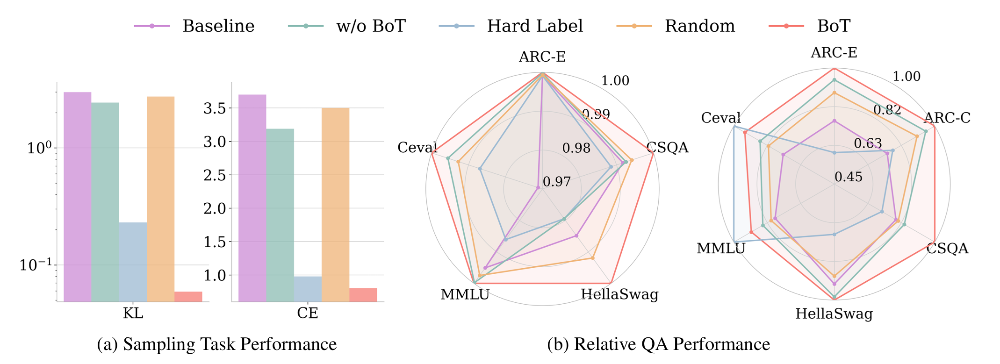

# Bag-of-Tokens Tuning: Calibrating LLM Logits with Contextual Probabilities


## Why Bag-of-Tokens Tuning?
Token probabilities play a central role in large language models. However, these probabilities often fail to reflect either answer correctness or probability distributions explicitly specified in the context. We attribute this failure to the **Context-Logit Probability Gap**: contextual probabilities are not reliably reflected in the model’s next-token logits. 


We propose **Bag-of-Tokens (BoT) tuning**, a very simple fine-tuning approach that directly calibrates the logits with the probability distribution conveyed by synthetic contexts.


Experiments show that BoT tuning generalizes to LLM-based sampling tasks, such as random-number generation, and improves downstream QA accuracy and calibration. These results suggest that **calibrating LLM logits with contextual probabilities provides a lightweight and effective way to enhance their uncertainty awareness.**


## Installation

Python 3.10 or newer is required. Install the pinned core environment:

```bash
python -m venv .venv
source .venv/bin/activate
python -m pip install --upgrade pip
python -m pip install -e .
```


## Prepare data

The checked-in Qwen candidate split can be used directly. To regenerate it from
a supplied Qwen tokenizer:

```bash
python data/generate_candidates.py \
  --model-name-or-path <MODEL_PATH> \
  --output-dir data/candidates
```

Generate BOT train/eval/OOD files with the paper defaults:

```bash
python data/generate_soft_labels.py \
  --train-candidates data/candidates/qwen_train.txt \
  --test-candidates data/candidates/qwen_test.txt \
  --output-dir data/generated/uniform \
  --samples 10 \
  --candidates-per-sample 4 \
  --prompts-per-sample 1 \
  --mode uniform \
  --seed 44 \
  --split-seed 200
```

BOT and normal-QA files share this JSONL shape:

```json
{"messages":[{"role":"user","content":"..."},{"role":"assistant","content":""}],"candidates":["yes","no"],"soft_label":[1.0,0.0],"task_type":"binary"}
```

Canonical task types are `bot`, `binary`, and `4choice`. Each candidate must map
to exactly one token under the supplied Qwen tokenizer. See
[`data/README.md`](data/README.md) and the checked-in examples for the full
schema. A normal-QA converter is not included because benchmark selection and
licensing are external to this method; convert the chosen benchmark to the
documented schema with one-hot targets.

## Train

The configuration order is built-in defaults, then YAML, then explicit CLI
arguments. A single-GPU run is:

```bash
llm-sl-train \
  --config configs/qwen_soft_label.yaml \
  --model-name-or-path <MODEL_PATH> \
  --soft-label-data data/generated/uniform/train.jsonl \
  --normal-qa-data <NORMAL_QA_JSONL> \
  --output-dir <OUTPUT_DIR>
```

For multiple GPUs:

```bash
torchrun --nproc-per-node 4 -m llm_sl.train \
  --config configs/qwen_soft_label.yaml \
  --model-name-or-path <MODEL_PATH> \
  --soft-label-data data/generated/uniform/train.jsonl \
  --normal-qa-data <NORMAL_QA_JSONL> \
  --output-dir <OUTPUT_DIR>
```

By default the concatenated BOT/QA dataset is shuffled in its natural
proportions. To sample an explicit BOT:QA proportion, add for example
`--batch-sample-ratio 2:1`. This changes sampling only; both groups still use KL.

Enable the provided ZeRO-2 configuration with:

```bash
llm-sl-train \
  --config configs/qwen_soft_label.yaml \
  --model-name-or-path <MODEL_PATH> \
  --soft-label-data data/generated/uniform/train.jsonl \
  --normal-qa-data <NORMAL_QA_JSONL> \
  --output-dir <OUTPUT_DIR> \
  --deepspeed-config configs/deepspeed_zero2_bf16.json
```

Add `--use-wandb` after installing the W&B extra. The default project and run
names can be overridden with `--wandb-project` and `--wandb-run-name`.

Checkpoint directories are written under `<OUTPUT_DIR>/checkpoint-*`. Automatic
resume is enabled and selects the latest checkpoint in the output directory.
Use `--no-auto-resume` to disable it or
`--resume-from-checkpoint <CHECKPOINT_PATH>` to select one explicitly. The final
model and tokenizer are also saved to `<OUTPUT_DIR>`.


## Citation and license

### Citation

If you use Bag-of-Tokens Tuning in your research, please cite:

```bibtex
@inproceedings{qiu2026bag,
  title={Bag-of-Tokens Tuning: Calibrating LLM Logits with Contextual Probabilities},
  author={Qiu, Chen-Meng and Wang, Ze-Hao and Wang, Deng-Bao and Yue, Linan and Zhang, Min-Ling},
  booktitle={Proceedings of the 2026 Conference on Empirical Methods in Natural Language Processing},
  pages={36198--36215},
  year={2026}
}
```

### License

The code is released under the [MIT License](LICENSE).
